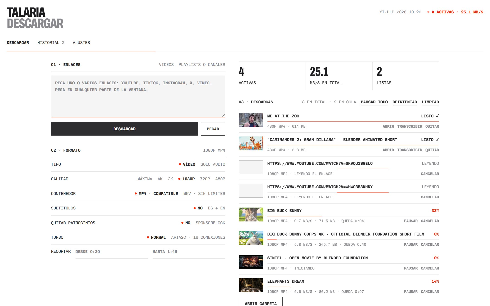
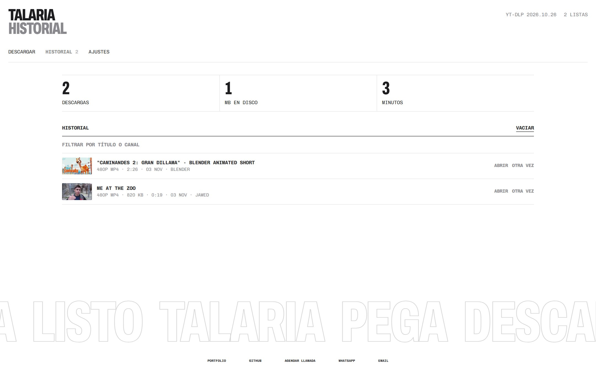
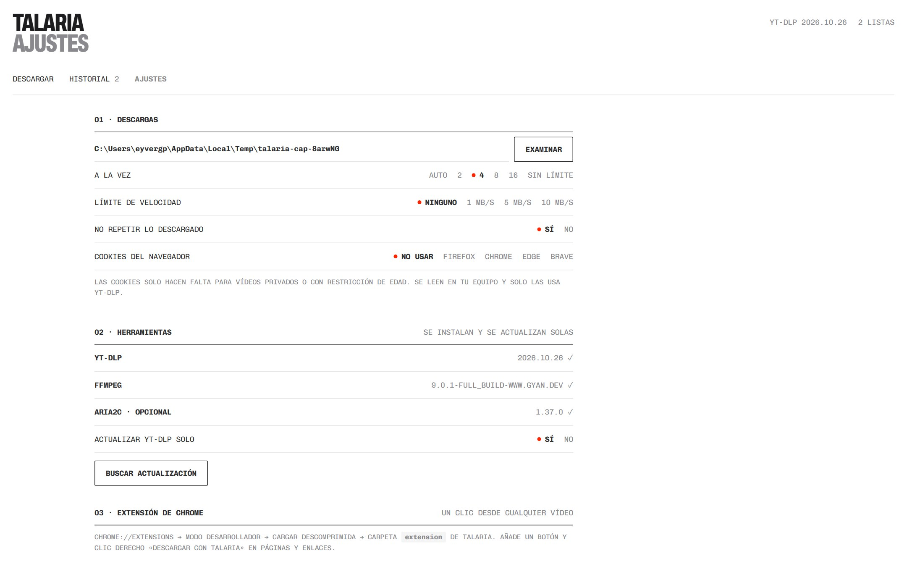
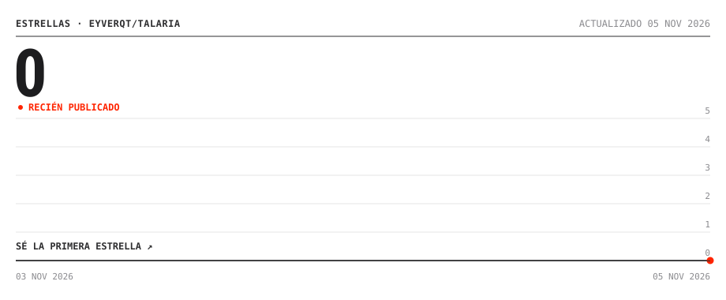

<h1>TALARIA</h1>

<p><samp>DESCARGADOR&nbsp;LOCAL&nbsp;&nbsp;&nbsp;&nbsp;&nbsp;&nbsp;<b>PEGA,&nbsp;DESCARGA&nbsp;Y&nbsp;LISTO</b>&nbsp;&nbsp;&nbsp;&nbsp;&nbsp;&nbsp;<b>●&nbsp;v1.0&nbsp;·&nbsp;PÚBLICO</b></samp></p>

<br>

<p align="center"></p>

<p align="center"><samp><a href="#instalar"><b>↓&nbsp;INSTALAR&nbsp;EN&nbsp;WINDOWS</b></a>&nbsp;&nbsp;&nbsp;&nbsp;&nbsp;&nbsp;<a href="#por-que"><b>POR&nbsp;QUÉ&nbsp;TALARIA</b></a>&nbsp;&nbsp;&nbsp;&nbsp;&nbsp;&nbsp;<a href="https://eyverqt.netlify.app"><b>PORTFOLIO</b></a></samp></p>

<br>

<p align="center"><samp>
<b>TALARIA:&nbsp;&nbsp;&nbsp;&nbsp;&nbsp;&nbsp;&nbsp;&nbsp;&nbsp;&nbsp;&nbsp;&nbsp;&nbsp;&nbsp;(SIN&nbsp;CUENTAS,&nbsp;SIN&nbsp;ANUNCIOS,&nbsp;SIN&nbsp;TOPES)&nbsp;&nbsp;&nbsp;&nbsp;&nbsp;</b><br>
<br>
<b>ÍNDICE&nbsp;01:&nbsp;QUÉ&nbsp;HACE&nbsp;&nbsp;&nbsp;(ENLACE&nbsp;→&nbsp;VÍDEO&nbsp;O&nbsp;AUDIO&nbsp;EN&nbsp;MÁXIMA&nbsp;CALIDAD)&nbsp;</b><br>
<br>
<b>ÍNDICE&nbsp;02:&nbsp;NOVEDADES&nbsp;&nbsp;(v1.0:&nbsp;CUATRO&nbsp;DESCARGADORES&nbsp;EN&nbsp;UNO)&nbsp;&nbsp;&nbsp;&nbsp;&nbsp;&nbsp;&nbsp;&nbsp;</b><br>
<br>
<b>ÍNDICE&nbsp;03:&nbsp;POR&nbsp;QUÉ&nbsp;&nbsp;&nbsp;&nbsp;(LO&nbsp;MEDIDO&nbsp;Y&nbsp;FRENTE&nbsp;A&nbsp;QUIÉN)&nbsp;&nbsp;&nbsp;&nbsp;&nbsp;&nbsp;&nbsp;&nbsp;&nbsp;&nbsp;&nbsp;&nbsp;&nbsp;&nbsp;&nbsp;</b><br>
<br>
<b>ÍNDICE&nbsp;04:&nbsp;INSTALAR&nbsp;&nbsp;&nbsp;(SOLO&nbsp;WINDOWS&nbsp;Y&nbsp;NODE&nbsp;20&nbsp;O&nbsp;SUPERIOR)&nbsp;&nbsp;&nbsp;&nbsp;&nbsp;&nbsp;&nbsp;&nbsp;</b><br>
<br>
<b>ÍNDICE&nbsp;05:&nbsp;USAR&nbsp;&nbsp;&nbsp;&nbsp;&nbsp;&nbsp;&nbsp;(PEGAR,&nbsp;ELEGIR&nbsp;Y&nbsp;SOLTAR)&nbsp;&nbsp;&nbsp;&nbsp;&nbsp;&nbsp;&nbsp;&nbsp;&nbsp;&nbsp;&nbsp;&nbsp;&nbsp;&nbsp;&nbsp;&nbsp;&nbsp;&nbsp;&nbsp;</b><br>
<br>
<b>ÍNDICE&nbsp;06:&nbsp;GALERÍA&nbsp;&nbsp;&nbsp;&nbsp;(HISTORIAL,&nbsp;AJUSTES&nbsp;Y&nbsp;EXTENSIÓN)&nbsp;&nbsp;&nbsp;&nbsp;&nbsp;&nbsp;&nbsp;&nbsp;&nbsp;&nbsp;&nbsp;</b><br>
<br>
<b>ÍNDICE&nbsp;07:&nbsp;LICENCIA&nbsp;&nbsp;&nbsp;(CÓDIGO&nbsp;MIT,&nbsp;CONTENIDO&nbsp;©&nbsp;EYVER&nbsp;GÓMEZ)&nbsp;&nbsp;&nbsp;&nbsp;&nbsp;&nbsp;</b><br>
<br>
<br>
<br>
Pega&nbsp;un&nbsp;enlace&nbsp;y&nbsp;baja&nbsp;el&nbsp;vídeo&nbsp;o&nbsp;el&nbsp;audio&nbsp;en&nbsp;la&nbsp;máxima&nbsp;calidad.&nbsp;&nbsp;<br>
YouTube,&nbsp;TikTok,&nbsp;Instagram,&nbsp;X&nbsp;y&nbsp;más&nbsp;de&nbsp;mil&nbsp;sitios,&nbsp;con&nbsp;yt-dlp.&nbsp;&nbsp;&nbsp;<br>
Una&nbsp;cola&nbsp;con&nbsp;límite:&nbsp;una&nbsp;playlist&nbsp;de&nbsp;200&nbsp;no&nbsp;tumba&nbsp;tu&nbsp;equipo.&nbsp;&nbsp;&nbsp;&nbsp;&nbsp;<br>
Si&nbsp;el&nbsp;sitio&nbsp;cambia,&nbsp;se&nbsp;actualiza&nbsp;y&nbsp;reintenta&nbsp;sin&nbsp;que&nbsp;hagas&nbsp;nada.&nbsp;<br>
Sin&nbsp;instalar&nbsp;nada&nbsp;más&nbsp;que&nbsp;Node.&nbsp;Arranca&nbsp;en&nbsp;una&nbsp;décima&nbsp;de&nbsp;segundo.
</samp></p>

<br>

<p align="center"><samp>
<b>ÍNDICE&nbsp;01:&nbsp;QUÉ&nbsp;HACE&nbsp;&nbsp;&nbsp;(ENLACE&nbsp;→&nbsp;VÍDEO&nbsp;O&nbsp;AUDIO&nbsp;EN&nbsp;MÁXIMA&nbsp;CALIDAD)&nbsp;&nbsp;&nbsp;&nbsp;&nbsp;</b><br>
<br>
Pegas&nbsp;uno&nbsp;o&nbsp;varios&nbsp;enlaces,&nbsp;vídeos,&nbsp;playlists&nbsp;o&nbsp;canales,&nbsp;en&nbsp;cualquier<br>
parte&nbsp;de&nbsp;la&nbsp;ventana.&nbsp;La&nbsp;página&nbsp;responde&nbsp;al&nbsp;instante&nbsp;y&nbsp;cada&nbsp;descarga&nbsp;&nbsp;<br>
aparece&nbsp;con&nbsp;su&nbsp;progreso,&nbsp;velocidad&nbsp;y&nbsp;tiempo&nbsp;restante.&nbsp;&nbsp;&nbsp;&nbsp;&nbsp;&nbsp;&nbsp;&nbsp;&nbsp;&nbsp;&nbsp;&nbsp;&nbsp;&nbsp;&nbsp;&nbsp;<br>
<br>
<b>CÓMO&nbsp;FUNCIONA:&nbsp;&nbsp;&nbsp;&nbsp;&nbsp;&nbsp;&nbsp;&nbsp;&nbsp;&nbsp;&nbsp;&nbsp;&nbsp;&nbsp;&nbsp;&nbsp;&nbsp;&nbsp;&nbsp;&nbsp;&nbsp;&nbsp;&nbsp;&nbsp;&nbsp;&nbsp;&nbsp;&nbsp;&nbsp;&nbsp;&nbsp;&nbsp;&nbsp;&nbsp;&nbsp;&nbsp;&nbsp;&nbsp;&nbsp;&nbsp;&nbsp;&nbsp;&nbsp;&nbsp;&nbsp;&nbsp;&nbsp;&nbsp;&nbsp;&nbsp;&nbsp;&nbsp;&nbsp;&nbsp;&nbsp;</b><br>
<br>
ENLACE&nbsp;·&nbsp;PLAYLIST&nbsp;·&nbsp;CANAL&nbsp;&nbsp;&nbsp;&nbsp;&nbsp;&nbsp;&nbsp;&nbsp;&nbsp;&nbsp;&nbsp;&nbsp;&nbsp;&nbsp;&nbsp;&nbsp;&nbsp;&nbsp;&nbsp;&nbsp;&nbsp;&nbsp;&nbsp;&nbsp;&nbsp;&nbsp;&nbsp;&nbsp;&nbsp;&nbsp;&nbsp;&nbsp;&nbsp;&nbsp;&nbsp;&nbsp;&nbsp;&nbsp;&nbsp;&nbsp;&nbsp;&nbsp;&nbsp;&nbsp;<br>
→&nbsp;LEER&nbsp;&nbsp;&nbsp;&nbsp;&nbsp;&nbsp;&nbsp;&nbsp;(HASTA&nbsp;4&nbsp;A&nbsp;LA&nbsp;VEZ,&nbsp;SIN&nbsp;REPETIR&nbsp;LA&nbsp;EXTRACCIÓN)&nbsp;&nbsp;&nbsp;&nbsp;&nbsp;&nbsp;&nbsp;&nbsp;&nbsp;&nbsp;<br>
→&nbsp;COLA&nbsp;&nbsp;&nbsp;&nbsp;&nbsp;&nbsp;&nbsp;&nbsp;(AUTO,&nbsp;2,&nbsp;4,&nbsp;8,&nbsp;16&nbsp;O&nbsp;SIN&nbsp;LÍMITE)&nbsp;&nbsp;&nbsp;&nbsp;&nbsp;&nbsp;&nbsp;&nbsp;&nbsp;&nbsp;&nbsp;&nbsp;&nbsp;&nbsp;&nbsp;&nbsp;&nbsp;&nbsp;&nbsp;&nbsp;&nbsp;&nbsp;&nbsp;<br>
→&nbsp;DESCARGAR&nbsp;&nbsp;&nbsp;(MP4,&nbsp;MKV,&nbsp;MP3,&nbsp;M4A,&nbsp;OPUS,&nbsp;FLAC,&nbsp;WAV)&nbsp;&nbsp;&nbsp;&nbsp;&nbsp;&nbsp;&nbsp;&nbsp;&nbsp;&nbsp;&nbsp;&nbsp;&nbsp;&nbsp;&nbsp;&nbsp;&nbsp;&nbsp;<br>
→&nbsp;SI&nbsp;FALLA&nbsp;&nbsp;&nbsp;&nbsp;(ACTUALIZA&nbsp;YT-DLP,&nbsp;CAMBIA&nbsp;DE&nbsp;CLIENTE,&nbsp;REINTENTA)&nbsp;&nbsp;&nbsp;&nbsp;&nbsp;&nbsp;&nbsp;<br>
→&nbsp;HISTORIAL&nbsp;&nbsp;&nbsp;(NO&nbsp;VUELVE&nbsp;A&nbsp;BAJAR&nbsp;LO&nbsp;QUE&nbsp;YA&nbsp;TIENES)&nbsp;&nbsp;&nbsp;&nbsp;&nbsp;&nbsp;&nbsp;&nbsp;&nbsp;&nbsp;&nbsp;&nbsp;&nbsp;&nbsp;&nbsp;&nbsp;&nbsp;&nbsp;&nbsp;<br>
→&nbsp;TIRO&nbsp;&nbsp;&nbsp;&nbsp;&nbsp;&nbsp;&nbsp;&nbsp;(TRANSCRIBE&nbsp;LO&nbsp;DESCARGADO,&nbsp;EN&nbsp;TU&nbsp;EQUIPO)&nbsp;&nbsp;&nbsp;&nbsp;&nbsp;&nbsp;&nbsp;&nbsp;&nbsp;&nbsp;&nbsp;&nbsp;&nbsp;&nbsp;&nbsp;
</samp></p>

<br>

<p align="center"><samp>
<b>ÍNDICE&nbsp;02:&nbsp;NOVEDADES&nbsp;&nbsp;(v1.0:&nbsp;CUATRO&nbsp;DESCARGADORES&nbsp;EN&nbsp;UNO)&nbsp;&nbsp;&nbsp;&nbsp;&nbsp;&nbsp;&nbsp;</b><br>
<br>
<b>2026-11&nbsp;·&nbsp;TALARIA&nbsp;1.0&nbsp;&nbsp;&nbsp;&nbsp;&nbsp;&nbsp;&nbsp;&nbsp;&nbsp;&nbsp;&nbsp;&nbsp;&nbsp;&nbsp;&nbsp;&nbsp;&nbsp;&nbsp;&nbsp;&nbsp;&nbsp;&nbsp;&nbsp;&nbsp;&nbsp;&nbsp;&nbsp;&nbsp;&nbsp;&nbsp;&nbsp;&nbsp;&nbsp;&nbsp;&nbsp;&nbsp;&nbsp;&nbsp;&nbsp;&nbsp;&nbsp;&nbsp;&nbsp;</b><br>
<br>
Sale&nbsp;de&nbsp;unir&nbsp;YT&nbsp;Turbo,&nbsp;Descargador&nbsp;de&nbsp;Vídeo&nbsp;y&nbsp;MediaDownloader,&nbsp;y<br>
sustituye&nbsp;a&nbsp;la&nbsp;extensión&nbsp;de&nbsp;terceros&nbsp;por&nbsp;una&nbsp;propia.&nbsp;&nbsp;&nbsp;&nbsp;&nbsp;&nbsp;&nbsp;&nbsp;&nbsp;&nbsp;&nbsp;&nbsp;<br>
<br>
●&nbsp;SIN&nbsp;DEPENDENCIAS&nbsp;&nbsp;&nbsp;&nbsp;(NI&nbsp;NPM&nbsp;INSTALL&nbsp;NI&nbsp;BUILD:&nbsp;SOLO&nbsp;NODE)&nbsp;&nbsp;&nbsp;&nbsp;&nbsp;&nbsp;<br>
●&nbsp;EXTENSIÓN&nbsp;PROPIA&nbsp;&nbsp;&nbsp;&nbsp;(UN&nbsp;CLIC&nbsp;Y&nbsp;CLIC&nbsp;DERECHO&nbsp;EN&nbsp;CHROME)&nbsp;&nbsp;&nbsp;&nbsp;&nbsp;&nbsp;&nbsp;&nbsp;<br>
●&nbsp;PAUSAR&nbsp;Y&nbsp;REANUDAR&nbsp;&nbsp;&nbsp;(SIGUE&nbsp;DONDE&nbsp;IBA,&nbsp;NO&nbsp;EMPIEZA&nbsp;DE&nbsp;CERO)&nbsp;&nbsp;&nbsp;&nbsp;&nbsp;<br>
●&nbsp;RECORTAR&nbsp;&nbsp;&nbsp;&nbsp;&nbsp;&nbsp;&nbsp;&nbsp;&nbsp;&nbsp;&nbsp;&nbsp;(BAJA&nbsp;SOLO&nbsp;DEL&nbsp;0:30&nbsp;AL&nbsp;1:45)&nbsp;&nbsp;&nbsp;&nbsp;&nbsp;&nbsp;&nbsp;&nbsp;&nbsp;&nbsp;&nbsp;&nbsp;&nbsp;&nbsp;<br>
●&nbsp;SPONSORBLOCK&nbsp;&nbsp;&nbsp;&nbsp;&nbsp;&nbsp;&nbsp;&nbsp;(QUITA&nbsp;PATROCINIOS&nbsp;DEL&nbsp;VÍDEO)&nbsp;&nbsp;&nbsp;&nbsp;&nbsp;&nbsp;&nbsp;&nbsp;&nbsp;&nbsp;&nbsp;&nbsp;&nbsp;
</samp></p>

<br>

<a id="por-que"></a>

<p align="center"><samp>
<b>ÍNDICE&nbsp;03:&nbsp;POR&nbsp;QUÉ&nbsp;&nbsp;&nbsp;&nbsp;(LO&nbsp;MEDIDO&nbsp;Y&nbsp;FRENTE&nbsp;A&nbsp;QUIÉN)&nbsp;&nbsp;&nbsp;&nbsp;&nbsp;&nbsp;&nbsp;&nbsp;&nbsp;&nbsp;&nbsp;&nbsp;&nbsp;&nbsp;&nbsp;&nbsp;&nbsp;&nbsp;&nbsp;&nbsp;&nbsp;&nbsp;&nbsp;&nbsp;&nbsp;</b><br>
<br>
<b>LO&nbsp;MEDIDO&nbsp;(PORTÁTIL&nbsp;I5-1035G1,&nbsp;~8&nbsp;MB/S&nbsp;POR&nbsp;DESCARGA):&nbsp;&nbsp;&nbsp;&nbsp;&nbsp;&nbsp;&nbsp;&nbsp;&nbsp;&nbsp;&nbsp;&nbsp;&nbsp;&nbsp;&nbsp;&nbsp;&nbsp;&nbsp;&nbsp;&nbsp;&nbsp;&nbsp;</b><br>
<br>
ARRANQUE&nbsp;&nbsp;&nbsp;&nbsp;&nbsp;&nbsp;&nbsp;&nbsp;&nbsp;&nbsp;&nbsp;&nbsp;&nbsp;&nbsp;&nbsp;&nbsp;0,09&nbsp;S&nbsp;HASTA&nbsp;RESPONDER&nbsp;&nbsp;&nbsp;&nbsp;&nbsp;&nbsp;&nbsp;&nbsp;&nbsp;&nbsp;&nbsp;&nbsp;&nbsp;&nbsp;&nbsp;&nbsp;&nbsp;&nbsp;&nbsp;&nbsp;&nbsp;&nbsp;&nbsp;&nbsp;&nbsp;&nbsp;&nbsp;&nbsp;&nbsp;<br>
PRIMERA&nbsp;VEZ&nbsp;&nbsp;&nbsp;&nbsp;&nbsp;&nbsp;&nbsp;&nbsp;&nbsp;&nbsp;&nbsp;&nbsp;&nbsp;10&nbsp;S:&nbsp;BAJA&nbsp;YT-DLP&nbsp;Y&nbsp;ARIA2C&nbsp;SOLOS&nbsp;&nbsp;&nbsp;&nbsp;&nbsp;&nbsp;&nbsp;&nbsp;&nbsp;&nbsp;&nbsp;&nbsp;&nbsp;&nbsp;&nbsp;&nbsp;&nbsp;&nbsp;&nbsp;<br>
4&nbsp;A&nbsp;LA&nbsp;VEZ&nbsp;&nbsp;&nbsp;&nbsp;&nbsp;&nbsp;&nbsp;&nbsp;&nbsp;&nbsp;&nbsp;&nbsp;&nbsp;&nbsp;10-16&nbsp;MB/S&nbsp;EN&nbsp;TOTAL,&nbsp;FRENTE&nbsp;A&nbsp;~8&nbsp;DE&nbsp;UNA&nbsp;&nbsp;&nbsp;&nbsp;&nbsp;&nbsp;&nbsp;&nbsp;&nbsp;&nbsp;&nbsp;&nbsp;<br>
8&nbsp;VÍDEOS&nbsp;CORTOS&nbsp;&nbsp;&nbsp;&nbsp;&nbsp;&nbsp;&nbsp;&nbsp;&nbsp;36-38&nbsp;S,&nbsp;FRENTE&nbsp;A&nbsp;39-42&nbsp;S&nbsp;EN&nbsp;SERIE&nbsp;&nbsp;&nbsp;&nbsp;&nbsp;&nbsp;&nbsp;&nbsp;&nbsp;&nbsp;&nbsp;&nbsp;&nbsp;&nbsp;&nbsp;&nbsp;&nbsp;<br>
UN&nbsp;SOLO&nbsp;VÍDEO&nbsp;(148&nbsp;MB)&nbsp;&nbsp;18-19&nbsp;S,&nbsp;IGUAL&nbsp;QUE&nbsp;YT-DLP&nbsp;SOLO&nbsp;&nbsp;&nbsp;&nbsp;&nbsp;&nbsp;&nbsp;&nbsp;&nbsp;&nbsp;&nbsp;&nbsp;&nbsp;&nbsp;&nbsp;&nbsp;&nbsp;&nbsp;&nbsp;&nbsp;&nbsp;<br>
<br>
El&nbsp;Turbo&nbsp;con&nbsp;aria2c&nbsp;fue&nbsp;más&nbsp;lento&nbsp;en&nbsp;YouTube&nbsp;(25&nbsp;s&nbsp;frente&nbsp;a&nbsp;19&nbsp;s):&nbsp;&nbsp;&nbsp;&nbsp;&nbsp;&nbsp;&nbsp;&nbsp;&nbsp;<br>
por&nbsp;eso&nbsp;viene&nbsp;apagado.&nbsp;Actívalo&nbsp;solo&nbsp;en&nbsp;sitios&nbsp;que&nbsp;limiten&nbsp;cada&nbsp;conexión.&nbsp;&nbsp;<br>
<br>
<b>FRENTE&nbsp;A&nbsp;LOS&nbsp;DEMÁS&nbsp;(NOVIEMBRE&nbsp;DE&nbsp;2026):&nbsp;&nbsp;&nbsp;&nbsp;&nbsp;&nbsp;&nbsp;&nbsp;&nbsp;&nbsp;&nbsp;&nbsp;&nbsp;&nbsp;&nbsp;&nbsp;&nbsp;&nbsp;&nbsp;&nbsp;&nbsp;&nbsp;&nbsp;&nbsp;&nbsp;&nbsp;&nbsp;&nbsp;&nbsp;&nbsp;&nbsp;&nbsp;&nbsp;&nbsp;&nbsp;&nbsp;</b><br>
<br>
YOUWEE&nbsp;&nbsp;&nbsp;&nbsp;&nbsp;&nbsp;&nbsp;&nbsp;&nbsp;&nbsp;MÁS&nbsp;FUNCIONES&nbsp;(IA,&nbsp;PLUGINS,&nbsp;SUBTÍTULOS).&nbsp;HAY&nbsp;QUE&nbsp;INSTALARLA<br>
4K&nbsp;DOWNLOADER+&nbsp;&nbsp;TOPE&nbsp;DIARIO&nbsp;GRATIS,&nbsp;ANUNCIOS,&nbsp;DESDE&nbsp;~15&nbsp;USD/AÑO&nbsp;&nbsp;&nbsp;&nbsp;&nbsp;&nbsp;&nbsp;&nbsp;&nbsp;&nbsp;&nbsp;&nbsp;<br>
YTDOWNLOADER&nbsp;&nbsp;&nbsp;&nbsp;LIBRE&nbsp;Y&nbsp;POPULAR,&nbsp;HECHA&nbsp;EN&nbsp;ELECTRON&nbsp;&nbsp;&nbsp;&nbsp;&nbsp;&nbsp;&nbsp;&nbsp;&nbsp;&nbsp;&nbsp;&nbsp;&nbsp;&nbsp;&nbsp;&nbsp;&nbsp;&nbsp;&nbsp;&nbsp;&nbsp;&nbsp;&nbsp;&nbsp;&nbsp;<br>
ARCDLP&nbsp;&nbsp;&nbsp;&nbsp;&nbsp;&nbsp;&nbsp;&nbsp;&nbsp;&nbsp;LIBRE,&nbsp;EN&nbsp;ELECTRON,&nbsp;COLA&nbsp;DE&nbsp;UNA&nbsp;EN&nbsp;UNA&nbsp;&nbsp;&nbsp;&nbsp;&nbsp;&nbsp;&nbsp;&nbsp;&nbsp;&nbsp;&nbsp;&nbsp;&nbsp;&nbsp;&nbsp;&nbsp;&nbsp;&nbsp;&nbsp;&nbsp;&nbsp;<br>
COBALT&nbsp;&nbsp;&nbsp;&nbsp;&nbsp;&nbsp;&nbsp;&nbsp;&nbsp;&nbsp;WEB,&nbsp;DEPENDE&nbsp;DE&nbsp;UN&nbsp;SERVIDOR&nbsp;AJENO&nbsp;&nbsp;&nbsp;&nbsp;&nbsp;&nbsp;&nbsp;&nbsp;&nbsp;&nbsp;&nbsp;&nbsp;&nbsp;&nbsp;&nbsp;&nbsp;&nbsp;&nbsp;&nbsp;&nbsp;&nbsp;&nbsp;&nbsp;&nbsp;&nbsp;&nbsp;<br>
<br>
<b>LO&nbsp;QUE&nbsp;TALARIA&nbsp;HACE&nbsp;DISTINTO:&nbsp;&nbsp;&nbsp;&nbsp;&nbsp;&nbsp;&nbsp;&nbsp;&nbsp;&nbsp;&nbsp;&nbsp;&nbsp;&nbsp;&nbsp;&nbsp;&nbsp;&nbsp;&nbsp;&nbsp;&nbsp;&nbsp;&nbsp;&nbsp;&nbsp;&nbsp;&nbsp;&nbsp;&nbsp;&nbsp;&nbsp;&nbsp;&nbsp;&nbsp;&nbsp;&nbsp;&nbsp;&nbsp;&nbsp;&nbsp;&nbsp;&nbsp;&nbsp;&nbsp;&nbsp;&nbsp;</b><br>
<br>
●&nbsp;CERO&nbsp;INSTALACIÓN&nbsp;&nbsp;&nbsp;&nbsp;(CARPETA&nbsp;Y&nbsp;LISTO:&nbsp;SIN&nbsp;INSTALADOR&nbsp;NI&nbsp;ELECTRON)&nbsp;&nbsp;&nbsp;&nbsp;&nbsp;&nbsp;&nbsp;&nbsp;<br>
●&nbsp;SE&nbsp;REPARA&nbsp;SOLO&nbsp;&nbsp;&nbsp;&nbsp;&nbsp;&nbsp;(YT-DLP&nbsp;AL&nbsp;DÍA&nbsp;Y&nbsp;REINTENTOS&nbsp;POR&nbsp;TIPO&nbsp;DE&nbsp;ERROR)&nbsp;&nbsp;&nbsp;&nbsp;&nbsp;&nbsp;&nbsp;<br>
●&nbsp;ERRORES&nbsp;CLAROS&nbsp;&nbsp;&nbsp;&nbsp;&nbsp;&nbsp;(DICE&nbsp;QUÉ&nbsp;HACER,&nbsp;NO&nbsp;UN&nbsp;VOLCADO&nbsp;TÉCNICO)&nbsp;&nbsp;&nbsp;&nbsp;&nbsp;&nbsp;&nbsp;&nbsp;&nbsp;&nbsp;&nbsp;&nbsp;&nbsp;&nbsp;<br>
●&nbsp;NO&nbsp;REPITE&nbsp;&nbsp;&nbsp;&nbsp;&nbsp;&nbsp;&nbsp;&nbsp;&nbsp;&nbsp;&nbsp;(MISMO&nbsp;VÍDEO&nbsp;Y&nbsp;FORMATO:&nbsp;YA&nbsp;LO&nbsp;TIENES)&nbsp;&nbsp;&nbsp;&nbsp;&nbsp;&nbsp;&nbsp;&nbsp;&nbsp;&nbsp;&nbsp;&nbsp;&nbsp;&nbsp;&nbsp;&nbsp;<br>
●&nbsp;API&nbsp;CERRADA&nbsp;&nbsp;&nbsp;&nbsp;&nbsp;&nbsp;&nbsp;&nbsp;&nbsp;(UNA&nbsp;WEB&nbsp;AJENA&nbsp;NO&nbsp;PUEDE&nbsp;ORDENAR&nbsp;DESCARGAS)&nbsp;&nbsp;&nbsp;&nbsp;&nbsp;&nbsp;&nbsp;&nbsp;&nbsp;&nbsp;&nbsp;<br>
●&nbsp;CON&nbsp;TIRO&nbsp;&nbsp;&nbsp;&nbsp;&nbsp;&nbsp;&nbsp;&nbsp;&nbsp;&nbsp;&nbsp;&nbsp;(DESCARGA&nbsp;Y&nbsp;TRANSCRIBE,&nbsp;SIN&nbsp;SALIR&nbsp;DE&nbsp;TU&nbsp;PC)&nbsp;&nbsp;&nbsp;&nbsp;&nbsp;&nbsp;&nbsp;&nbsp;&nbsp;&nbsp;<br>
<br>
Si&nbsp;quieres&nbsp;IA,&nbsp;plugins&nbsp;o&nbsp;editar&nbsp;subtítulos,&nbsp;Youwee&nbsp;hace&nbsp;más.&nbsp;&nbsp;&nbsp;&nbsp;&nbsp;&nbsp;&nbsp;&nbsp;&nbsp;&nbsp;&nbsp;&nbsp;&nbsp;&nbsp;&nbsp;<br>
Talaria&nbsp;es&nbsp;para&nbsp;pegar,&nbsp;bajar&nbsp;y&nbsp;seguir&nbsp;con&nbsp;lo&nbsp;tuyo.&nbsp;&nbsp;&nbsp;&nbsp;&nbsp;&nbsp;&nbsp;&nbsp;&nbsp;&nbsp;&nbsp;&nbsp;&nbsp;&nbsp;&nbsp;&nbsp;&nbsp;&nbsp;&nbsp;&nbsp;&nbsp;&nbsp;&nbsp;&nbsp;&nbsp;
</samp></p>

<br>

<a id="instalar"></a>

<p align="center"><samp>
<b>ÍNDICE&nbsp;04:&nbsp;INSTALAR&nbsp;&nbsp;&nbsp;(SOLO&nbsp;WINDOWS&nbsp;Y&nbsp;NODE&nbsp;20&nbsp;O&nbsp;SUPERIOR)&nbsp;&nbsp;&nbsp;&nbsp;&nbsp;&nbsp;&nbsp;&nbsp;&nbsp;&nbsp;&nbsp;&nbsp;&nbsp;</b><br>
<br>
No&nbsp;hay&nbsp;npm&nbsp;install&nbsp;ni&nbsp;build.&nbsp;yt-dlp,&nbsp;FFmpeg&nbsp;y&nbsp;aria2c&nbsp;se&nbsp;instalan&nbsp;solos<br>
la&nbsp;primera&nbsp;vez,&nbsp;en&nbsp;paralelo,&nbsp;en&nbsp;la&nbsp;carpeta&nbsp;bin.&nbsp;&nbsp;&nbsp;&nbsp;&nbsp;&nbsp;&nbsp;&nbsp;&nbsp;&nbsp;&nbsp;&nbsp;&nbsp;&nbsp;&nbsp;&nbsp;&nbsp;&nbsp;&nbsp;&nbsp;&nbsp;&nbsp;&nbsp;
</samp></p>


```bash
git clone https://github.com/eyverqt/talaria.git
cd talaria
start.bat
```

<p align="center"><samp>
Se&nbsp;abre&nbsp;en&nbsp;http://127.0.0.1:5241/.&nbsp;Si&nbsp;no&nbsp;tienes&nbsp;Node:
</samp></p>


```bash
winget install OpenJS.NodeJS.LTS
```

<p align="center"><samp>
<b>EXTENSIÓN&nbsp;DE&nbsp;CHROME:&nbsp;&nbsp;&nbsp;&nbsp;&nbsp;&nbsp;&nbsp;&nbsp;&nbsp;&nbsp;&nbsp;&nbsp;&nbsp;&nbsp;&nbsp;&nbsp;&nbsp;&nbsp;&nbsp;&nbsp;&nbsp;&nbsp;&nbsp;&nbsp;&nbsp;&nbsp;&nbsp;&nbsp;&nbsp;&nbsp;&nbsp;&nbsp;&nbsp;&nbsp;&nbsp;&nbsp;&nbsp;&nbsp;&nbsp;&nbsp;&nbsp;&nbsp;&nbsp;&nbsp;&nbsp;&nbsp;&nbsp;&nbsp;&nbsp;&nbsp;&nbsp;&nbsp;</b><br>
<br>
chrome://extensions&nbsp;→&nbsp;modo&nbsp;desarrollador&nbsp;→&nbsp;cargar&nbsp;descomprimida&nbsp;→&nbsp;&nbsp;&nbsp;&nbsp;&nbsp;&nbsp;&nbsp;<br>
carpeta&nbsp;extension.&nbsp;Añade&nbsp;un&nbsp;botón&nbsp;y&nbsp;el&nbsp;clic&nbsp;derecho&nbsp;en&nbsp;cualquier&nbsp;enlace.
</samp></p>

<br>

<p align="center"><samp>
<b>ÍNDICE&nbsp;05:&nbsp;USAR&nbsp;&nbsp;&nbsp;&nbsp;&nbsp;&nbsp;&nbsp;(PEGAR,&nbsp;ELEGIR&nbsp;Y&nbsp;SOLTAR)&nbsp;&nbsp;&nbsp;&nbsp;&nbsp;&nbsp;&nbsp;&nbsp;&nbsp;&nbsp;&nbsp;&nbsp;&nbsp;&nbsp;&nbsp;&nbsp;&nbsp;&nbsp;&nbsp;&nbsp;&nbsp;&nbsp;&nbsp;&nbsp;&nbsp;&nbsp;&nbsp;&nbsp;&nbsp;</b><br>
<br>
PEGA&nbsp;Y&nbsp;CTRL+ENTER&nbsp;&nbsp;&nbsp;&nbsp;&nbsp;&nbsp;&nbsp;&nbsp;&nbsp;→&nbsp;EMPIEZA&nbsp;CON&nbsp;EL&nbsp;FORMATO&nbsp;ELEGIDO&nbsp;&nbsp;&nbsp;&nbsp;&nbsp;&nbsp;&nbsp;&nbsp;&nbsp;&nbsp;&nbsp;&nbsp;&nbsp;&nbsp;&nbsp;&nbsp;&nbsp;<br>
PEGA&nbsp;UNA&nbsp;PLAYLIST&nbsp;&nbsp;&nbsp;&nbsp;&nbsp;&nbsp;&nbsp;&nbsp;&nbsp;→&nbsp;UN&nbsp;TRABAJO&nbsp;POR&nbsp;VÍDEO,&nbsp;EN&nbsp;SU&nbsp;SUBCARPETA&nbsp;&nbsp;&nbsp;&nbsp;&nbsp;&nbsp;&nbsp;&nbsp;&nbsp;<br>
ARRASTRA&nbsp;UN&nbsp;ENLACE&nbsp;&nbsp;&nbsp;&nbsp;&nbsp;&nbsp;&nbsp;&nbsp;→&nbsp;CAE&nbsp;EN&nbsp;LA&nbsp;CAJA&nbsp;&nbsp;&nbsp;&nbsp;&nbsp;&nbsp;&nbsp;&nbsp;&nbsp;&nbsp;&nbsp;&nbsp;&nbsp;&nbsp;&nbsp;&nbsp;&nbsp;&nbsp;&nbsp;&nbsp;&nbsp;&nbsp;&nbsp;&nbsp;&nbsp;&nbsp;&nbsp;&nbsp;&nbsp;&nbsp;&nbsp;&nbsp;&nbsp;<br>
DESDE&nbsp;0:30&nbsp;HASTA&nbsp;1:45&nbsp;&nbsp;&nbsp;&nbsp;&nbsp;→&nbsp;BAJA&nbsp;SOLO&nbsp;ESE&nbsp;TROZO&nbsp;&nbsp;&nbsp;&nbsp;&nbsp;&nbsp;&nbsp;&nbsp;&nbsp;&nbsp;&nbsp;&nbsp;&nbsp;&nbsp;&nbsp;&nbsp;&nbsp;&nbsp;&nbsp;&nbsp;&nbsp;&nbsp;&nbsp;&nbsp;&nbsp;&nbsp;&nbsp;&nbsp;<br>
VÍDEO&nbsp;PRIVADO&nbsp;O&nbsp;CON&nbsp;EDAD&nbsp;&nbsp;→&nbsp;ELIGE&nbsp;COOKIES&nbsp;EN&nbsp;AJUSTES&nbsp;&nbsp;&nbsp;&nbsp;&nbsp;&nbsp;&nbsp;&nbsp;&nbsp;&nbsp;&nbsp;&nbsp;&nbsp;&nbsp;&nbsp;&nbsp;&nbsp;&nbsp;&nbsp;&nbsp;&nbsp;&nbsp;&nbsp;<br>
TRANSCRIBIR&nbsp;&nbsp;&nbsp;&nbsp;&nbsp;&nbsp;&nbsp;&nbsp;&nbsp;&nbsp;&nbsp;&nbsp;&nbsp;&nbsp;&nbsp;→&nbsp;LO&nbsp;MANDA&nbsp;A&nbsp;LA&nbsp;COLA&nbsp;DE&nbsp;TIRO&nbsp;&nbsp;&nbsp;&nbsp;&nbsp;&nbsp;&nbsp;&nbsp;&nbsp;&nbsp;&nbsp;&nbsp;&nbsp;&nbsp;&nbsp;&nbsp;&nbsp;&nbsp;&nbsp;&nbsp;&nbsp;<br>
<br>
Descarga&nbsp;solo&nbsp;contenido&nbsp;sobre&nbsp;el&nbsp;que&nbsp;tengas&nbsp;derechos&nbsp;o&nbsp;cuya&nbsp;licencia&nbsp;&nbsp;&nbsp;&nbsp;&nbsp;&nbsp;&nbsp;<br>
lo&nbsp;permita.&nbsp;Respetar&nbsp;las&nbsp;condiciones&nbsp;de&nbsp;cada&nbsp;sitio&nbsp;es&nbsp;cosa&nbsp;de&nbsp;quien&nbsp;lo&nbsp;usa.
</samp></p>

<br>

<p align="center"><samp>
<b>ÍNDICE&nbsp;06:&nbsp;GALERÍA&nbsp;&nbsp;&nbsp;&nbsp;(HISTORIAL,&nbsp;AJUSTES&nbsp;Y&nbsp;EXTENSIÓN)</b>
</samp></p>

<p align="center">&nbsp;</p>


<details>
<summary><samp><b>ESTRUCTURA&nbsp;DEL&nbsp;PROYECTO</b></samp></summary>

```text
talaria/
├── start.bat            # Comprueba Node y arranca
├── server/
│   ├── index.mjs        # Servidor sin dependencias, API y sucesos en vivo
│   ├── downloads.mjs    # Cola, formatos, progreso y recuperación de errores
│   └── tools.mjs        # Instala y actualiza yt-dlp, FFmpeg y aria2c
├── public/              # Interfaz con el estilo eyverqt, sin build
├── extension/           # Extensión de Chrome propia
└── scripts/estrellas.py # La gráfica de estrellas (GitHub Actions)
```

</details>

<br>

<p align="center"><samp>
<b>ÍNDICE&nbsp;07:&nbsp;LICENCIA&nbsp;&nbsp;&nbsp;(CÓDIGO&nbsp;MIT,&nbsp;CONTENIDO&nbsp;©&nbsp;EYVER&nbsp;GÓMEZ)&nbsp;&nbsp;&nbsp;&nbsp;&nbsp;&nbsp;&nbsp;&nbsp;&nbsp;&nbsp;&nbsp;&nbsp;&nbsp;&nbsp;</b><br>
<br>
Código&nbsp;bajo&nbsp;MIT.&nbsp;Contenido&nbsp;y&nbsp;diseño&nbsp;©&nbsp;Eyver&nbsp;Gómez.&nbsp;&nbsp;&nbsp;&nbsp;&nbsp;&nbsp;&nbsp;&nbsp;&nbsp;&nbsp;&nbsp;&nbsp;&nbsp;&nbsp;&nbsp;&nbsp;&nbsp;&nbsp;&nbsp;&nbsp;&nbsp;&nbsp;&nbsp;<br>
yt-dlp,&nbsp;FFmpeg&nbsp;y&nbsp;aria2c&nbsp;se&nbsp;descargan&nbsp;aparte&nbsp;y&nbsp;mantienen&nbsp;sus&nbsp;licencias.&nbsp;&nbsp;&nbsp;<br>
<br>
<b>PRIVACIDAD:&nbsp;&nbsp;&nbsp;&nbsp;&nbsp;&nbsp;&nbsp;&nbsp;&nbsp;&nbsp;&nbsp;&nbsp;&nbsp;&nbsp;&nbsp;&nbsp;&nbsp;&nbsp;&nbsp;&nbsp;&nbsp;&nbsp;&nbsp;&nbsp;&nbsp;&nbsp;&nbsp;&nbsp;&nbsp;&nbsp;&nbsp;&nbsp;&nbsp;&nbsp;&nbsp;&nbsp;&nbsp;&nbsp;&nbsp;&nbsp;&nbsp;&nbsp;&nbsp;&nbsp;&nbsp;&nbsp;&nbsp;&nbsp;&nbsp;&nbsp;&nbsp;&nbsp;&nbsp;&nbsp;&nbsp;&nbsp;&nbsp;&nbsp;&nbsp;&nbsp;&nbsp;&nbsp;</b><br>
<br>
Sin&nbsp;cuentas,&nbsp;sin&nbsp;telemetría&nbsp;y&nbsp;sin&nbsp;servidores&nbsp;propios.&nbsp;Ajustes&nbsp;e&nbsp;historial<br>
viven&nbsp;en&nbsp;Documents\Talaria.&nbsp;Las&nbsp;cookies&nbsp;solo&nbsp;las&nbsp;lee&nbsp;yt-dlp&nbsp;en&nbsp;tu&nbsp;equipo.
</samp></p>

<br>

<p align="center"><samp>
<b>ESTRELLAS:&nbsp;&nbsp;&nbsp;&nbsp;&nbsp;&nbsp;&nbsp;&nbsp;&nbsp;&nbsp;&nbsp;&nbsp;(SE&nbsp;REDIBUJA&nbsp;SOLA&nbsp;CON&nbsp;CADA&nbsp;ESTRELLA)</b>
</samp></p>

<p align="center"><a href="https://github.com/eyverqt/talaria/stargazers"></a></p>

<br>

<p align="center"><sub><samp><a href="https://eyverqt.netlify.app"><b>PORTFOLIO</b></a>&nbsp;&nbsp;&nbsp;&nbsp;&nbsp;&nbsp;<a href="https://github.com/eyverqt/tiro"><b>TIRO</b></a>&nbsp;&nbsp;&nbsp;&nbsp;&nbsp;&nbsp;<a href="https://github.com/eyverqt"><b>GITHUB</b></a>&nbsp;&nbsp;&nbsp;&nbsp;&nbsp;&nbsp;<a href="https://cal.com/eyverqt/15min"><b>AGENDAR&nbsp;LLAMADA</b></a>&nbsp;&nbsp;&nbsp;&nbsp;&nbsp;&nbsp;<a href="https://wa.me/573127115299"><b>WHATSAPP</b></a>&nbsp;&nbsp;&nbsp;&nbsp;&nbsp;&nbsp;<a href="mailto:eyverqt@gmail.com"><b>EMAIL</b></a>&nbsp;&nbsp;&nbsp;&nbsp;&nbsp;&nbsp;<a href="LICENSE"><b>LICENCIA</b></a></samp></sub></p>
